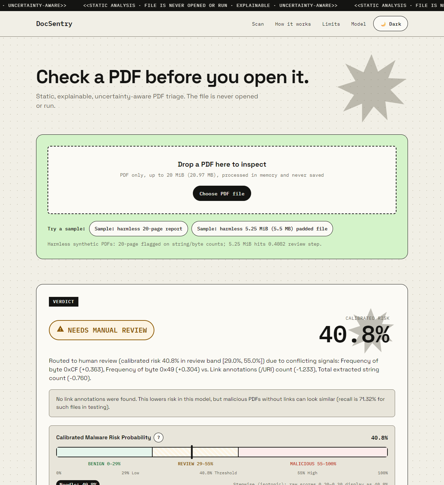
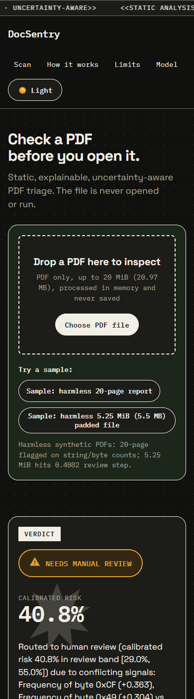

# DocSentry

**DocSentry** is a static, calibrated, explainable PDF malware triage engine trained on the EMBER2024 PDF benchmark subset ([FutureComputing4AI/EMBER2024](https://github.com/FutureComputing4AI/EMBER2024)). It inspects raw byte histograms, byte-entropy distributions, printable strings, and structural indicators without ever opening, rendering, or executing the PDF, and pairs an Isotonic Regression calibrator with a manual-review band (`[0.290, 0.550]`), per-document SHAP attributions, and out-of-distribution (OOD) percentile checks.

| Desktop (1280 px, Light) | Mobile (390 px, Dark) |
| :---: | :---: |
|  |  |

---

## Benchmark Results (EMBER2024 Test Set, N = 12,000)

| Operating Point | Accuracy | Precision | Recall | FPR | F1-Score | ROC-AUC | Review Rate |
| :--- | :--- | :--- | :--- | :--- | :--- | :--- | :--- |
| **Raw XGBoost (`t = 0.50`)** | `0.9475` | `0.9900` | `0.9042` `[0.8971, 0.9116]` | `0.0092` `[0.0070, 0.0115]` | `0.9451` `[0.9410, 0.9494]` | `0.9887` `[0.9870, 0.9904]` | — |
| **Calibrated XGBoost (`t = 0.4083`, band `[0.290, 0.550]`)** | `0.9538` | `0.9792` | `0.9273` | `0.0197` | `0.9526` | `0.9887` | `3.77%` |

*(Bracketed intervals are 1,000-resample bootstrap 95% CIs at `t = 0.50` from `reports/model_card_metrics.json`; calibrated metrics and review rate are from `MODEL_CARD.md` and `reports/uri_counterfactual.json`.)*

---

## Windows Quick Start

```powershell
# 1. Create and activate a virtual environment (Python 3.10+, tested on 3.13)
python -m venv .venv
.venv\Scripts\activate

# 2. Install exact pinned dependencies
pip install -r requirements.txt

# 3. Launch the local web app (or run uvicorn app.main:app --host 127.0.0.1 --port 8000)
run_app.bat
```

Once running:
- **Web UI**: `http://127.0.0.1:8000/`
- **OpenAPI Docs**: `http://127.0.0.1:8000/docs`
- **Health Check**: `http://127.0.0.1:8000/health`

To batch-scan a folder of PDFs from the CLI:
```bash
python scripts/scan_pdfs.py --folder data/demo_pdfs/synthetic --output reports/demo_scan_results.csv
```

---

## EMBER2024 Dataset & Research Notebooks

Raw EMBER2024 JSONL files (`data/raw/`) and processed Parquet datasets (`data/processed/*.parquet`) are git-ignored and **not** redistributed in this repository. The web application, CLI scanner, and API tests (`tests/test_api.py`) run immediately from a fresh clone using the tracked `models/` and `data/processed/feature_names.json` artifacts.

To reproduce the full data and training pipeline from scratch:
1. Install `requirements.txt` (includes `signify==0.7.1`, pinned for `thrember` compatibility) and download only the PDF subset into `data/raw/`:
   ```python
   import thrember
   thrember.download_dataset("data/raw", file_type="PDF")
   ```
2. Run the notebooks sequentially:
   - **Require `data/raw/` or `data/processed/*.parquet`**: `notebooks/01_data_understanding.ipynb`, `02_eda.ipynb`, `03_preprocessing.ipynb`, `04_modeling.ipynb`, `05_explain_uncertainty.ipynb`, `08_uri_counterfactual.ipynb`.
   - **Run on synthetic demo PDFs without the full dataset**: `notebooks/06_real_pdf_demo.ipynb`, `07_demo_diagnostics.ipynb`.

---

## Running Tests

- **Fresh clone (no dataset download required, 11 tests):**
  ```bash
  python -m unittest tests/test_api.py -v
  ```
- **Full suite (19 tests; `test_extract.py` and `test_infer.py` require `data/processed/X_test_tree.parquet` generated by Notebooks 01–03):**
  ```bash
  python -m unittest discover tests -v
  ```

---

## Folder Map

```text
DocSentry/
├── app/                        # FastAPI backend + offline HTML/CSS/JS UI (bundled OFL fonts)
├── data/
│   ├── demo_pdfs/synthetic/    # Harmless pure-Python synthetic PDFs for smoke testing
│   └── processed/              # feature_names.json, preprocessing_report.json, scaler.joblib
├── docs/
│   └── screenshots/            # Desktop (1280 px) & mobile (390 px) UI screenshots
├── models/                     # Champion XGBoost, Isotonic calibrator, thresholds, ablation models
├── notebooks/                  # Notebooks 01–08 (EDA, preprocessing, modeling, SHAP, audit)
├── reports/                    # Benchmark CSVs, JSON metrics, and 10 key summary figures
├── scripts/                    # CLI utilities (scan_pdfs, make_report_assets, verify_12_files)
├── src/                        # Static feature extractor & calibrated inference/SHAP engine
├── tests/                      # Unit tests (test_api, test_extract, test_infer)
├── LICENSE                     # MIT License
├── MODEL_CARD.md               # Detailed model card, operating points, and domain-shift audit
└── requirements.txt            # Pinned Python dependencies
```

---

## Safety Statement

DocSentry performs **pure static analysis** on raw PDF bytes and extracted printable strings. Uploaded PDFs are processed in memory, never saved to disk by the API, and **never opened, rendered, or executed**. Never execute live malware samples on a host machine.

---

## Honest Limitations

- **`/URI` link dependence & ablation balance**: In counterfactual tests where `/URI` is zeroed in the feature table on the shipped model, `1,814` link-bearing malicious test documents drop out of the `malicious` verdict (`1,619` to `needs_review`, `195` to `benign`), and recall at `t = 0.4083` falls from `92.73%` to `71.32%`. However, when XGBoost is retrained from scratch without `/URI` (657 features), test F1 is `0.9476` (`95% CI [0.9436, 0.9516]`) versus `0.9451` (`95% CI [0.9410, 0.9494]`) for the 658-feature control—overlapping intervals showing that link signal is partially redundant with other byte/string features in this corpus.
- **Temporal drift**: Validation F1 (`0.9824`, weeks 42–51) drops to `0.9451` on the future test split (weeks 52–63) at `t = 0.50`, reflecting distribution shift over time.
- **Small benign PDFs & synthetic demo files**: Minimal or low-string benign PDFs (such as `synthetic_a`, `synthetic_b`, `synthetic_c`) can trigger high raw scores from unusual string counts and byte histograms, while `synthetic_f` (`5.25 MiB` / `5.5 MB` padded) has a low raw score (`0.2080`) that lands on the isotonic calibrator's flat `0.4082` step (`needs_review`).
- **OOD envelope**: The out-of-distribution banner checks only `general_size` and `strings_numstrings` against the `0.5%`–`99.5%` training benign bounds and does not catch semantic shifts within normal size/string ranges.

---

## Documentation

- [MODEL_CARD.md](MODEL_CARD.md) — Complete model specifications, calibration analysis, error breakdown, and domain-shift check.

---

## Credits & Citation

Built upon the **EMBER2024** dataset and **thrember** feature extractor (`FutureComputing4AI/EMBER2024`), which are licensed under the **Apache License, Version 2.0 (January 2004)**. The EMBER2024 dataset itself is **not redistributed** in this repository.

```bibtex
@inproceedings{joyce2025ember,
      title={EMBER2024 - A Benchmark Dataset for Holistic Evaluation of Malware Classifiers},
      author={Robert J. Joyce and Gideon Miller and Phil Roth and Richard Zak and Elliott Zaresky-Williams and Hyrum Anderson and Edward Raff and James Holt},
      year={2025},
      booktitle={Proceedings of the 31st ACM SIGKDD Conference on Knowledge Discovery and Data Mining},
}
```

---

## License

MIT License, Copyright (c) 2026 Pragun. See [LICENSE](LICENSE).
